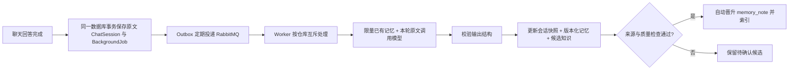

# 对话记忆工作台与可靠性改造

本地入口：<http://127.0.0.1:3001/memory>。主导航的「对话记忆」也可以进入。

## 页面怎么使用

先选仓库，再选会话。条目、冲突和候选知识可以按仓库浏览；聊天原文和执行状态需要选择一个具体会话。

| 视图 | 可以做什么 |
| --- | --- |
| 记忆条目 | 搜索、按状态/类型筛选、新增、编辑、固定、遗忘、恢复；详情展示有效期、半衰期和未来分数 |
| 冲突与版本 | 比较同一个事实键的新旧内容，选择保留或替换；条目详情中查看完整版本并回滚 |
| 聊天原文 | 在数据库中搜索当前会话的原始消息，支持中文和分页 |
| 待确认知识 | 查看来源、质量检查项与证据，重新校验、确认采纳或拒绝；目前展示仓库最近 100 条候选 |
| 执行状态 | 查看持久化计划、Agent 任务、待确认操作和最近的记忆提取任务；提取失败可重新入队 |

遗忘是软删除：停止自动记忆召回，同时保留版本和聊天原文。显式读取原文工具仍能找到当时的对话。恢复不会取消已有的有效期；已经到期的条目需要编辑有效期后才会重新参与召回。

更新请求带 `expected_version`。另一页面或 Worker 已经改过同一条目时，服务器返回 409，页面提示重新加载，避免覆盖最新修正。回滚也会产生新版本，历史记录不会被覆盖。

## 一轮聊天如何形成记忆



HTTP 请求不再等待会话整理模型。原文和任务先可靠落库，即使 MQ 暂时断开，Outbox 仍能在恢复后继续投递。原文落库不代表记忆已经提取完成，页面的执行状态用于观察这段最终一致的过程。

Worker 使用现有 `memory.enrich` 队列。任务在数据库中经历 `queued → running → completed`，临时错误进入 `retrying`，超过次数进入 `failed` 并走死信机制。默认最多 3 次，基础等待 5 秒，采用指数退避；429/限流响应尊重服务端等待时间。缺少密钥等永久配置错误不会无意义地反复执行。模型返回错误对象或字段类型不合法时，不能作为成功记忆封存。

失败后点击「重新提取」会为同一个原文片段创建后续任务；已有活动任务会合并，已完成的片段不会再次提取。运行视图按每个片段的最新任务投影，旧的失败记录不会让重试成功后的失败计数一直增加。

## 幂等与并发保护

- ChatSession 保存完整原文，重复封存同一组用户/助手消息会复用已有片段。
- BackgroundJob 的唯一活动键合并重复请求；Outbox、持久消息、发布确认和消费后手动 ACK 配合工作。
- Worker 持有 PostgreSQL 会话级仓库咨询锁，避免同仓库同步、文档索引和记忆提取互相覆盖；服务内多次提交不会释放这把独立连接上的锁。
- 已封存片段再次收到消息会直接完成，不会重复增加 `sessions_incorporated`。如果 Worker 在封存提交后、任务完成标记前退出，下一次处理会用封存状态对账。
- MemoryEntry 使用版本条件更新；MemoryRevision 每个条目/版本唯一。
- MemoryKeyClaim 对「会话 + 类型 + 事实键」建立唯一约束，主键与同义标识共享一个所有者。改名、回滚、手动新增和自动提取使用同一套约束，删除后的标识仍保留，防止旧内容被再次提取复活。
- 较旧会话任务晚完成时使用合并模式，不能覆盖更新会话的聚合摘要。
- 候选知识批准使用行锁与条件认领，并以候选 UUID 派生稳定的文档来源 UUID，重复批准不会生成多份知识。

这里实现的是消息可以重复投递、业务效果幂等，并不声称 MQ 天然实现了 exactly-once。

## 时间衰减与失效

召回分数：`重要度 × 置信度 × 2^(-距最后确认的天数 / 半衰期)`。默认半衰期 30 天；读取不会更新确认时间，重复模型抽取同一事实也不会续命。明确的人工编辑/确认形成新版本和确认时间。

固定只暂停分数衰减，不绕过有效期。过期、遗忘、待冲突条目的自动召回分数为 0。

| 类型 | 自动创建时默认有效期 |
| --- | --- |
| 事实、决策 | 180 天 |
| 待办任务 | 14 天 |
| 用户偏好 | 365 天 |
| 仓库背景 | 90 天 |
| 手工摘要 | 30 天 |

新建时可以明确选择长期有效。兼容旧记忆时保留原来的时间，不以本次读取时间刷新寿命。

关联的 RAG 文档带 `memory_entry_id` 和 `memory_entry_version`。每次召回都检查当前条目的版本、状态和有效期，过期或旧版本向量即使尚未物理清理，也不能进入当前回答。向量结果中的记忆分数还会应用时间衰减。

历史压缩摘要没有逐条事实来源。发生修正、遗忘、冲突或到期后，系统会保守停用可能夹带旧事实的自动摘要，改用当前记忆和精确原文恢复工具；原始聊天仍保留。近期原始消息本身仍是对话上下文，不等于可删除的记忆条目。

## 上下文预算与运行状态

`ContextAssembler` 每轮重新读取当前有效记忆和当前执行状态，再与最近消息、证据一起按预算装配。它不会把所有历史记忆塞入模型：已有记忆提取输入限制在约 1200 估算 token，模型本轮原文也有单独限制；管理记忆会先限量查询、排序，再按预算截取。

计划与 Agent 执行状态写入现有 `AgentWorkflowRun / AgentTaskRun`。计划确认、任务执行和结束都留下持久记录；API 重启会把中断运行标记出来。压缩后的下一轮会重新投影这些当前状态，不沿用压缩前旧的运行快照。待确认写操作仍按原来的 ActionDraft 权限与人工确认流程执行，记忆的自动晋升不会触发仓库写操作。

历史关键词检索改为数据库筛选：PostgreSQL `simple` 全文索引配合 `pg_trgm` 索引，中文使用子串匹配，仓库、会话、游标边界和分页都在 SQL 中处理。普通活动上下文的历史读取也在数据库中限量，兼容旧的压缩副本。若数据库账户没有安装 `pg_trgm` 的权限，系统会记录警告，使用 SQL 匹配降级，不能宣称获得同样的索引性能。

## 自动质量门禁的范围

候选需要有同仓库中真实存在的来源，引用必须逐字匹配，内容必须得到引用文本支持，置信度必须合法，并且通过敏感信息、版本和冲突检查，才有自动采纳资格。助手生成的回复或自动摘要不能自证为用户确认。

这是一套保守的来源与质量校验，不能证明外部资料本身绝对正确。没有可核对引用、转述差异较大或存在矛盾的候选仍需人工判断。事实身份主要依赖稳定事实键及同内容/历史版本匹配；不同键下的语义矛盾没有宣称实现通用语义识别。

## 实现入口

| 文件 | 责任 |
| --- | --- |
| `backend/app/services/memory_lifecycle.py` | CRUD、版本、事实身份、墓碑、有效期、衰减和限量召回 |
| `backend/app/services/memory_quality.py` | 来源核对与自动采纳资格 |
| `backend/app/services/memory_hub.py` | 候选采集、批准和知识晋升 |
| `backend/app/services/session_enrichment.py` | 异步会话整理任务处理 |
| `backend/app/services/message_search.py` | 数据库历史搜索与索引安装 |
| `backend/app/services/runtime_state.py` | 当前计划、Agent 与队列状态投影 |
| `backend/app/services/memory_recall.py` | 关联知识版本过滤与压缩摘要失效 |
| `frontend/components/memory/` | 记忆工作台、编辑器、详情和各视图 |

配置项 `MEMORY_ENRICHMENT_ENABLED=true`、`MEMORY_AUTO_APPROVE_VERIFIED=true` 默认开启。继续使用当前 `.env` 的模型与 RabbitMQ 配置，不需要另外申请 DeepSeek Key。

Qwen3 的后台结构化记忆请求关闭可选的 thinking，避免长对话先进行大量推理、超过 60 秒读取超时。普通聊天和其他模型的请求不添加这个参数。网络或模型故障仍交给持久任务有限重试，失败状态保留供排查，不能当作空记忆成功处理。

## 复验

从项目根目录执行：

```powershell
& backend/.venv/Scripts/python.exe scripts/verify_memory.py
```

此脚本创建带唯一标记的本地临时仓库，使用真实 PostgreSQL、RabbitMQ、当前模型和向量索引完成检查，最后只删除该精确临时仓库。需要保留用于页面验收时加 `--keep`；修复后只复验保留片段可用 `--resume`；完成后 `--cleanup` 会验证 UUID、仓库名称及标记再清理。

报告保存在 `.data/runtime/memory-verification.json`，后端回归日志在 `.data/runtime/memory-backend-tests.log`，前端构建日志在 `.data/runtime/memory-frontend-build.log`。测试会调用已配置的模型/Embedding 服务。
